# 5. Desktop app

The desktop app (`vault-gui`) does day-to-day vault work in a window:
create the vault, unlock it, find, copy, add and edit logins, generate
passwords, import, and manage unlock methods. It is a window onto `vaultd`
like the CLI: it never opens the vault file itself and holds no keys.

| | Linux | Windows | macOS |
|---|---|---|---|
| Desktop app | Yes (X11 or Wayland, OpenGL) | Yes | Not yet |
| Copied secrets kept out of clipboard history and cloud clipboard | No such feature on Linux desktops | Yes | Not yet |

Some things are only in the command line: creating, importing and using
SSH and OpenPGP keys ([chapters 6](06-ssh-and-git.md) and
[7](07-openpgp.md)), revoking unlock methods with key rotation, and finding
items for a website. The app lists key items and shows their fingerprint.

For a tour of the window (sidebar, item list, details), the **Ctrl K**
command palette and keyboard shortcuts, with screenshots, see
[The desktop window and command palette](desktop-window-and-palette.md).
This chapter covers setting up the app and each task step by step.

## Start it

`vaultd` must be running ([chapter 1](01-getting-started.md)).

- **Linux:** run `vault-gui`. To put it in your applications menu with its
  icon, from the source folder:

  1. Make sure `vault-gui` is on your `PATH`.
  2. Copy the menu entry:
     `cp contrib/desktop/dev.passwordvault.app.desktop ~/.local/share/applications/`
  3. Copy the icons:
     `mkdir -p ~/.local/share/icons && cp -r contrib/icons/hicolor ~/.local/share/icons/`
  4. If the menu still shows a blank icon, refresh the cache with
     `gtk-update-icon-cache -f -t ~/.local/share/icons/hicolor` (the command
     may be missing on some desktops; then sign out and back in).

  **Secret Vault** then appears in the applications menu with a red keyhole
  icon. To keep it in the dock or panel, open it and choose *Pin* or *Add to
  favorites* from its right-click menu.
- **Windows:** the installer adds **Secret Vault** to the Start menu (see
  [Installing and running on Windows](windows-install.md)). From a source
  build, run `target\release\vault-gui.exe` and pin it to Start or the
  taskbar from its right-click menu. The icon is built into the program, so
  there is nothing to copy.

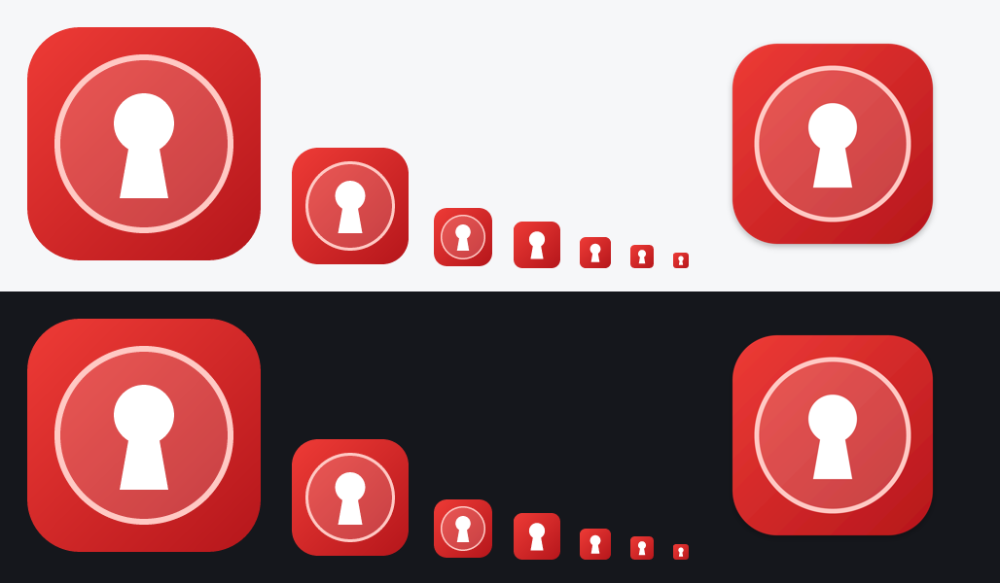

The icon is a white keyhole on a red tile. Below 48 px it draws a bigger
keyhole with no ring, so it stays readable in the tray and title bar.

| | Linux | Windows | macOS |
|---|---|---|---|
| Window and taskbar icon | Yes. On Wayland the dock reads it from the menu entry, so do steps 2 and 3 above | Yes, built into the program | Not yet (the app does not run on macOS yet; a `.icns` is ready in `contrib/icons/`) |
| Menu entry icon | After steps 2 and 3 above | Yes, from the installer | Not yet |

If the app says it cannot reach `vaultd`, start the daemon
(`systemctl --user start vaultd` on Linux; on Windows run `vaultw.exe`, or sign out and back in) and
press **Try again**.

## First run

### No vault yet: the setup wizard

The first time you open the app with no vault, a setup wizard walks you
through everything a new vault needs. The steps are listed down the left
side of the card: **Password**, **Recovery code**, **Unlock methods**,
**Browser**, **Finish**. Finished steps get a green tick and the current one
is blue, with "Step 2 of 4" above each page's title. Each page has **Back**
at the bottom left and the button to go on at the bottom right. Only the
first two steps are required; you can skip the rest and come back to them
later. In a narrow window (under about 750 points wide) the step list
folds into dots across the top.

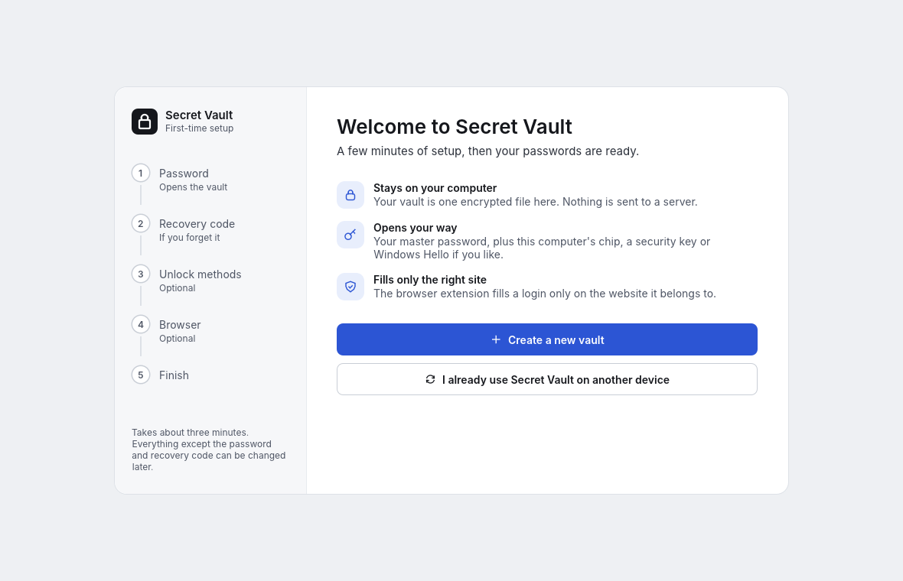

**Welcome.** Choose **Create a new vault**. If you already use Secret Vault
on another computer and sync it through OneDrive, Google Drive or Dropbox,
choose **I already use Secret Vault on another device** instead (see
[Join a synced vault](#join-a-synced-vault) below).

**1. Master password.** Type a master password of at least 8 characters and
repeat it. The bar under the first box shows how strong it looks: aim for
**Strong**. "They match" appears under the second box once both are the
same. Four or five random words (for example *orbit lantern velvet
canyon*, but not that one) are easy to remember and hard to guess. Nobody
can reset this password, so press **Create vault** only when you are sure
you will remember it. Creating the vault takes a few seconds.

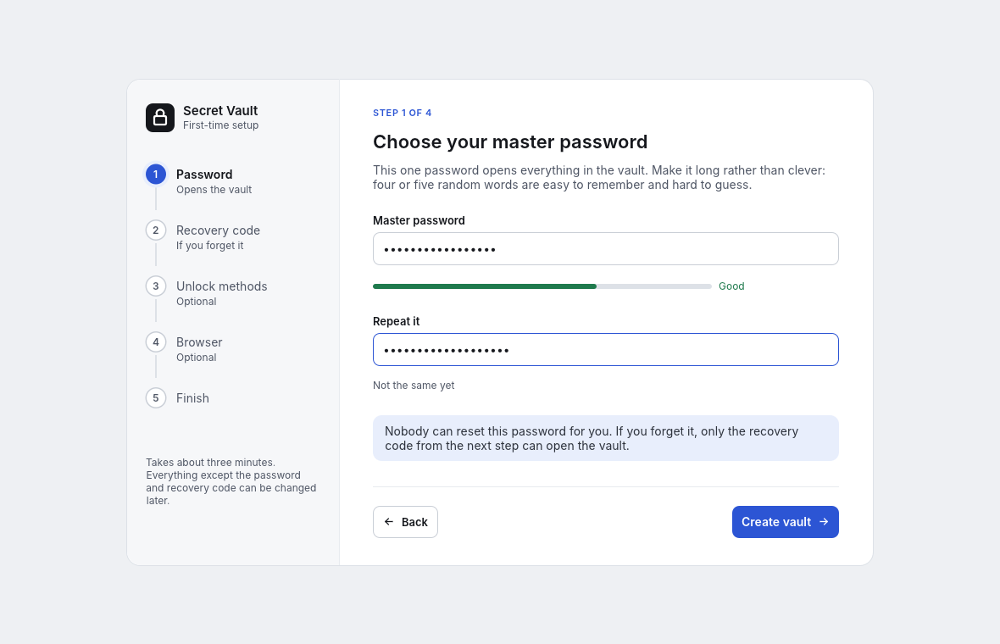

**2. Recovery code.** The app shows the vault's **recovery code** once, in
boxes, one group of characters each, so it's easy to copy onto paper. It
opens the vault on its own if you forget your password or lose your other
methods, so:

- write it on paper or print it, and keep it away from the computer;
- do not save it in a file, a screenshot or a photo on this computer.

Tick **I've written down my recovery code and put it somewhere safe**, then
press **Continue**. You can't go on until the box is ticked.

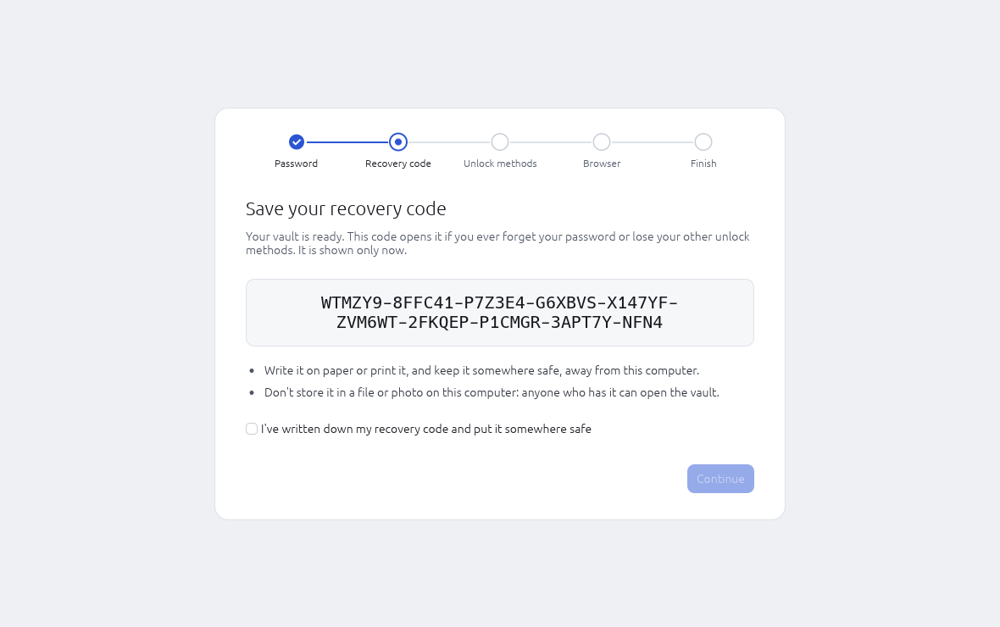

**3. Unlock methods (optional).** Add quicker or stronger ways to unlock.
Press **Set up** next to one, fill in its options and press **Add** (or
**Turn on**). You don't type your password again: the wizard uses the one
from step 1. Each method has an icon (chip, security key, Windows Hello)
that turns green, with **Added**, once you have added it.

| Method | What it does | Linux | Windows | macOS |
|---|---|---|---|---|
| Windows Hello | After a password unlock, your face, fingerprint or Windows PIN re-opens the vault for 8 hours, until the computer restarts | No | Yes, if Windows Hello is set up | No |
| This computer's TPM chip | Unlocking needs your password *and* this computer, so a copied vault file is useless elsewhere. Optional PIN | Yes, if the computer has a TPM 2.0 you may use | Yes | No (no TPM) |
| Security key | Unlocking needs your password and a touch on a FIDO2 key (YubiKey, Nitrokey, Titan) | Yes | Yes; Windows shows its own window for the touch and PIN | Yes |

On Windows, if your security key has a PIN, tick **Also ask for the key's
PIN every time**. Windows always checks that PIN, so a touch-only method
can't work with such a key.

Press **Continue** (or **Skip for now** if you added nothing). Everything
here can also be done later on the **Unlock methods** page.

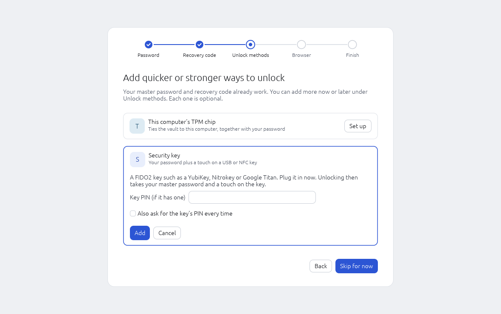

**4. Browser (optional, Linux and Windows).** Connect the browser
extension so it can fill your logins:

1. Load the extension in Chrome, Edge or Firefox (it is not in the stores
   yet; see [Browser autofill](04-browser-autofill.md#1-load-the-extension)).
2. Copy the extension's ID from its card on `chrome://extensions` or
   `edge://extensions` (32 letters, a to p) into **Chrome or Edge extension
   ID**. Tick **I also use Firefox** if you do. Press **Register**. The app
   runs `vault-native-host --install` for you; it must sit next to the app,
   as the installer puts it. When it is done you see **Registered with your
   browsers**.
3. In the browser, click the Secret Vault icon, then **Connect**, and press
   **Allow** in the window that opens.

On macOS this step only says that browser autofill is not available yet.
(The app can't be used on macOS yet, because vaultd doesn't run there.)

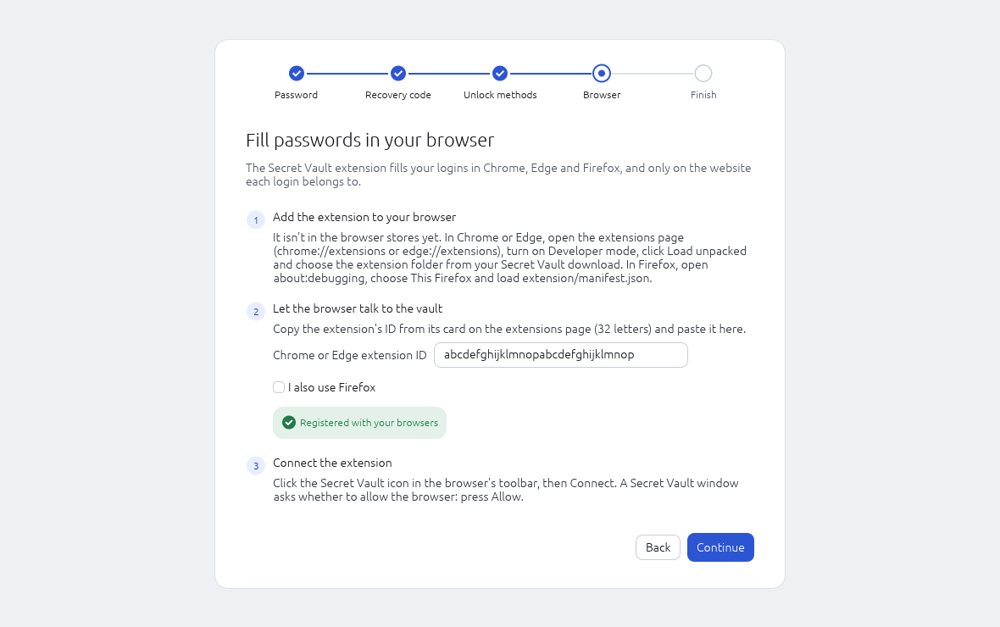

**5. Finish.** A summary card shows what you set up, with an empty circle
next to anything you skipped. Press **Open my vault**, or **Import passwords**
to bring in logins from Bitwarden or a browser's password export
([Import](#import)).

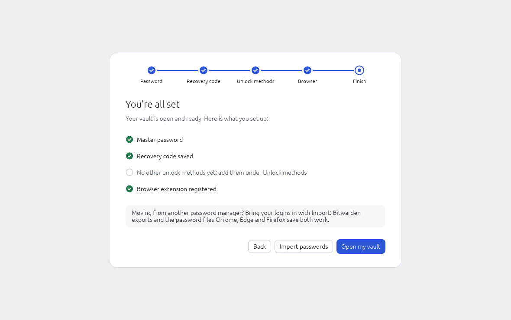

Good to know:

- The app is paired with the vault as soon as it is created, and the vault
  stays unlocked through the wizard.
- If the vault locks during the wizard (for example after 15 idle minutes),
  the wizard ends; unlock and finish the optional steps from **Unlock
  methods** instead.
- If you close the app half-way, the vault is already made. Next time the
  app shows the normal lock screen.

### Join a synced vault

On the welcome screen choose **I already use Secret Vault on another
device**, type the path of the vault file in your synced folder (for
example `C:\Users\alex\OneDrive\vault.svault`) and press **Join**. Then pair
the app with the master password you already use.

### A vault already exists

The app has to be paired with the vault once. Choose one:

- **Ask for approval:** press it, and allow the request in the window
  `vaultd` opens. Nothing to type.
- **Prove an unlock method:** pick Password, Security key, TPM or Recovery
  code, fill it in and press **Pair**. This also unlocks the vault.

The app keeps its own pairing, separate from the CLI's and the browser's.

## Unlock and lock

In the **Unlock with** list pick Password, Security key, This device (TPM)
or Recovery code, fill in what it asks and press **Unlock** (or Enter). For a security key, touch it when it
blinks. On Linux, type the key's PIN in **PIN (if set)** if the method
asks for it. On Windows there is no PIN box for a security key: Windows
opens its own window for the touch and, if needed, the PIN.

**Windows Hello (Windows).** With quick unlock turned on (see *Unlock
methods* below), the lock screen shows an **Unlock with Windows Hello**
button above the list for a while after each unlock with your password.
Press it and confirm with your face, fingerprint or Windows PIN in the
Windows Security window. When the time is up, or after a restart, the
button disappears and the password is needed again.
[Chapter 2](02-unlocking.md#quick-unlock-with-windows-hello-windows)
explains the details.

Lock with the **Lock** button at the top right (next to the time left
before the vault locks by itself) or **Ctrl+L**. The vault also locks when idle,
when the screen locks or the computer sleeps, or when another program locks
it; the app follows within two seconds and forgets everything it showed.

## Items

The middle column lists your items. Select an item to see it on the right.
Across the top of the window are the search bar, the blue **New** button
and **Lock**; they stay there on every page.

### Browse by category

The sidebar's top group picks which items the middle column shows:

| Sidebar entry | Shows |
| --- | --- |
| **All items** | Everything |
| **Logins** | Website and app logins (not keys) |
| **Secure notes** | Notes |
| **Cards** | Payment cards |
| **Identities** | Names and addresses for filling forms |
| **One-time codes** | Logins with a two-factor code set up |
| **SSH and PGP keys** | Keys only |

1. Click an entry in the sidebar. It turns white with a blue icon, and
   the heading of the middle column changes to match, for example
   **Secure notes**, with the number of items in it on the right.
2. The list shows only that kind of item.
3. If the category is empty, the list says so ("No secure notes yet.")
   and points you to the **New** button at the top.
4. If an item was open on the right and it isn't in the new category, it
   closes, so the right side shows "Pick an item on the left". A form you
   are filling in (a new or edited item, or a new key) stays open until
   you save or cancel it.

### Search

Type in the **search bar at the top** to filter by title, username or
website. While a category is open, search stays inside it: a small blue
tag such as **in Logins ×** at the start of the bar says so. Click the ×,
or **Search all items** under an empty result, to search everything.
Typing in the bar from **Generator**, **Import**, **Unlock methods** or
**Sync** takes you back to the item list. Opening an item from the
**Ctrl K** palette switches to **All items** when the item is in another
category, so you can see it in the list.

### Add an item: the New button

The blue button at the top right is named for what it makes in the open
category:

| Open category | Button |
| --- | --- |
| **All items** | **New item ▾**, a menu of every kind: Login, Secure note, Card, Identity, SSH key, OpenPGP key |
| **Logins**, **One-time codes** | **New login** |
| **Secure notes** | **New secure note** |
| **Cards** | **New card** |
| **Identities** | **New identity** |
| **SSH and PGP keys** | **New SSH key**, with a **▾** beside it for **New OpenPGP key** |

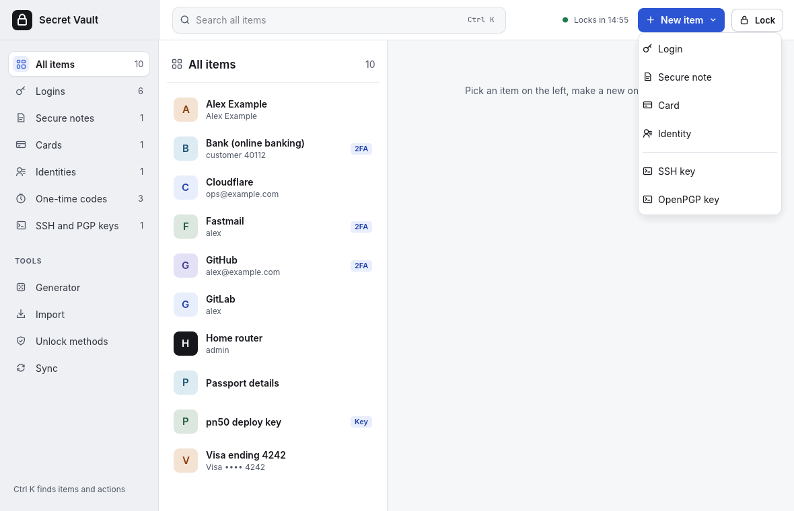

A one-time code isn't an item of its own: add one by editing a login and
pasting its 2FA setup key.

- Each value has its own copy button, such as **Copy username**, **Copy
  password**, **Copy number** or **Copy code** (when the item has a
  one-time code). **Show** reveals secret values in place; **Hide** covers
  them again.
- A **secure note's** text stays hidden until you press **Show**; **Copy
  note** copies it without showing it.
- **Edit** opens the form. **Delete** asks **Yes, delete** to confirm;
  there is no undo.

### SSH and PGP keys

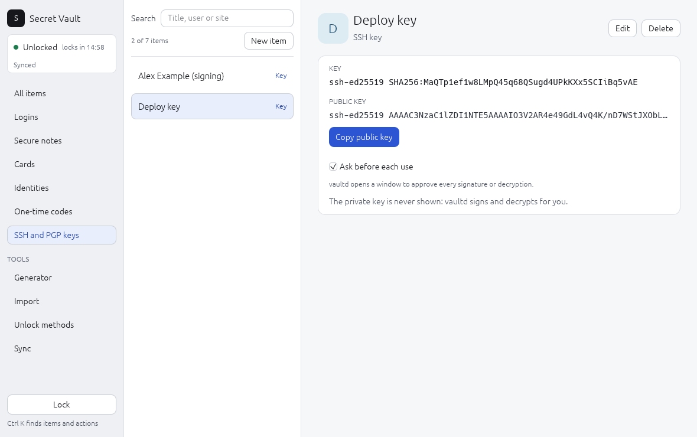

Keys you made in the app, or made or imported with `vault ssh` or
`vault pgp` ([chapter 6](06-ssh-and-git.md), [chapter 7](07-openpgp.md)),
are listed with a **Key** tag. Selecting one shows:

- **Key**: the type and fingerprint (for OpenPGP, also the name and email
  it was made for). Compare the fingerprint with what a server or a friend
  shows you.
- **Public key**: the line to paste into a server's `authorized_keys` or
  GitHub. **Copy public key** copies it. For an OpenPGP key it copies the
  armored block (`-----BEGIN PGP PUBLIC KEY BLOCK-----`) to send to people
  or upload to a key server. The public key is not secret.
- **Ask before each use**: when ticked (the default), `vaultd` opens a
  window to approve every signature or decryption with this key. Untick it
  only for a key a program must use unattended, such as a deploy key;
  then any program you run can use it while the vault is unlocked.

The private key itself is never shown in the app. To move it elsewhere,
use `vault ssh export` or `vault pgp export`, which ask you to prove an
unlock method again. Keys have no websites, so there is no autofill box.

### Make a new key

The key is made inside `vaultd`, the vault's background service. Its
private half goes straight into the vault and never reaches the app, the
screen or a file. You need the vault unlocked.

**An SSH key**, to log in to servers and git hosts or to sign git commits:

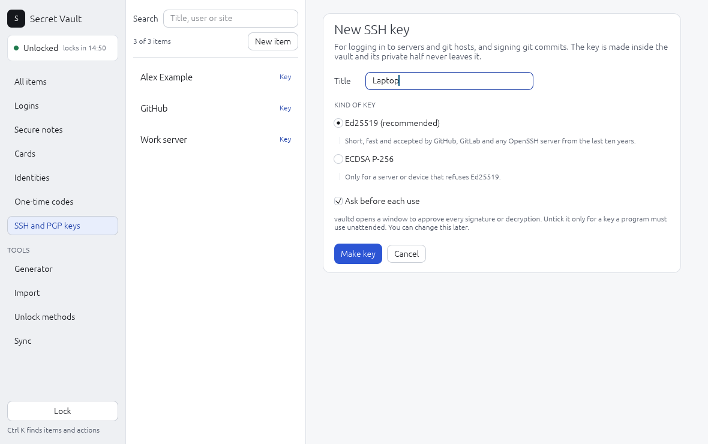

1. Open **SSH and PGP keys** in the sidebar and press **New SSH key** at
   the top right, or choose **SSH key** from **New item ▾** in All items
   (or press Ctrl K and run **New SSH key**).

   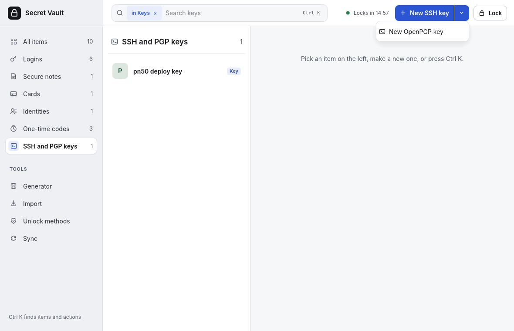

2. **Title**: what the key is for, such as "Laptop", "GitHub" or "Backup
   server". Use one key per computer or service, so you can remove one
   without touching the others.
3. **Kind of key**: keep **Ed25519**. Choose **ECDSA P-256** only for an
   old server or a device that refuses Ed25519. RSA keys can't be made or
   imported.
4. **Ask before each use** is ticked: each time a program wants to use the
   key, a window asks you first. Untick it only for a key that a script or
   service must use with nobody at the screen. You can change it later on
   the key's page.
5. Press **Make key**. The new key opens. Press **Copy public key** and
   paste the line into the server's `~/.ssh/authorized_keys` or GitHub's
   **Settings → SSH and GPG keys**. Then point `ssh` at the vault
   ([chapter 6, step 3](06-ssh-and-git.md#3-point-your-shell-at-the-vaults-agent)).

**An OpenPGP key**, to encrypt and sign files and email, or sign git
commits:

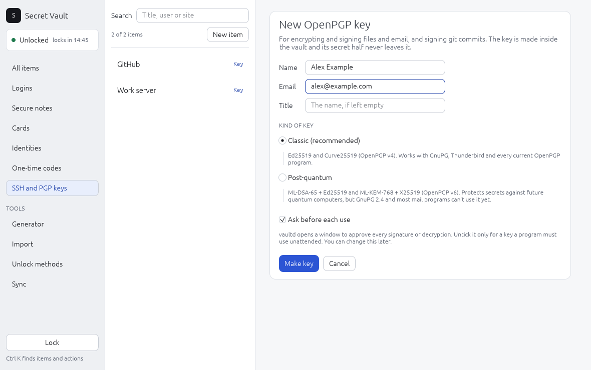

1. In **SSH and PGP keys**, press the **▾** next to **New SSH key** and
   choose **New OpenPGP key**, or choose **OpenPGP key** from **New item ▾**
   in All items (or Ctrl K, **New OpenPGP key**).
2. **Name**: the name people will see on the key, such as "Alex Example".
3. **Email**: the address the key is for, such as alex@example.com.
   Optional, but mail programs and git find your key by it.
4. **Title**: the key's name in your vault and in `vault pgp` commands.
   Leave it empty to use the name.
5. **Kind of key**:
   - **Classic** (recommended): works with GnuPG, Thunderbird and every
     current OpenPGP program.
   - **Post-quantum**: also safe against future quantum computers, for
     secrets that must stay secret for many years. GnuPG 2.4 and most mail
     programs can't read it yet, so only use it with people whose software
     can. See [Which kind of key](07-openpgp.md#which-kind-of-key).
6. **Ask before each use**, as for SSH keys.
7. Press **Make key**, then **Copy public key** and send the block to the
   people who will write to you, or publish it.

If something is missing, the form says so in red at the top (for
example "Type the name the key is for." or "That email address doesn't
look right.") and nothing is made. **Cancel** closes the form.

Importing an existing key and exporting a key's private half still use the
command line (`vault ssh import`/`export`, `vault pgp import`/`export`), as
do encrypting, decrypting and signing.

Platforms: making keys works the same on Linux and Windows. On Windows the
vault's SSH agent is a named pipe, which the built-in OpenSSH client uses
([chapter 6](06-ssh-and-git.md)). The app does not run on macOS yet.

The **New** button at the top right (see
[Add an item](#add-an-item-the-new-button)) opens an empty form for the
kind you choose. A login's form:

1. **Title** (required), **Username**.
2. **Password**: type it, or press **Generate** to make one with the
   Generator's settings.
3. **Websites**: type the address, then choose **This site only** (exact
   origin, the safe default) or **Whole domain** (all `https` subdomains).
   Tick **Allow http** only for an old site that has no `https`. **Add
   website** adds another address; **Remove** deletes one. See
   [Websites and matching](03-items.md#websites-and-matching).
4. **One-time codes**: paste the secret or the `otpauth://` link from the
   site's QR code. An invalid secret is refused with a message.
5. **Notes**, then **Save**.

A **card** has **Name on card**, **Card number**, **Expires** (`MM/YY`),
**Security code** and **PIN**. A number that fails the card checksum shows
a warning but can still be saved. An **identity** has a title such as Mr
or Dr, first, middle and last name, company, email, phone, three address
lines, city, state or region, postcode and country. A **secure note** has
only a title and notes.

Every kind has **Custom fields**: **Add field** adds a row with a **Name**,
a **Value** and a **Hidden** tick box that treats the value like a
password. **Remove** deletes a row. See [Item types](03-items.md#item-types).

### Clipboard

A copied value (username, password, code, card number and so on) is cleared from the clipboard after
30 seconds, when the vault locks and when the app closes, unless you have
copied something else since. On Windows it is also kept out of the
clipboard history (Win+V) and cloud clipboard sync.

## Generator

**Generator**, under Tools in the sidebar, makes passwords of 8 to 64 characters, with or
without **Symbols**, optionally avoiding look-alike characters. **Copy
password** copies the result. New items use these settings when you press
**Generate** in the item form.

## Import

1. Export from your old password manager
   ([how](03-items.md#import-from-another-password-manager)).
2. Open **Import** under Tools in the sidebar and choose the format: Bitwarden (unencrypted
   `.json`) or browser passwords (`.csv`, which also covers Safari).
3. Type or paste the full path of the file into **File** (there is no file
   picker yet) and press **Import**.
4. Delete the export file afterwards: it holds your passwords in plain text.

## Unlock methods

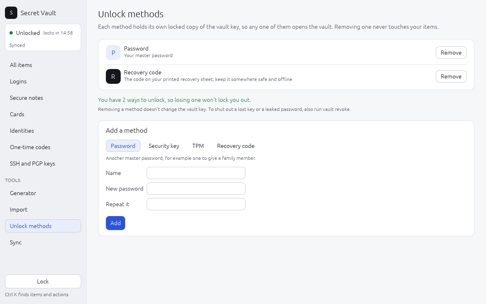

**Unlock methods**, under Tools in the sidebar, lists every way the vault
can be opened, one row each, with what it needs and the name you gave it.
Any one of them unlocks the vault on its own.

Under the list, a line counts them. With two or more it is green: losing
one won't lock you out. With only one it turns orange as a reminder to add
a recovery code or a second method, because if that one is lost, nothing
can open the vault.

**Remove** deletes a method after you press **Yes, remove** (this does not
rotate the vault key; for a lost or stolen factor use `vault revoke`, see
[chapter 2](02-unlocking.md#revoke-a-lost-or-stolen-factor)).

Under **Add a method**, pick Password, Security key, TPM or Recovery code.
A line under the choices says what each one is for. Give it a **Name**,
and fill in what it asks:

- **Password:** the new password, twice.
- **Security key:** your master password; tick **Also ask for the key's PIN
  every time** if you want the PIN required. Plug the key in, press **Add**
  and touch the key twice: once to register it and once to test it.
  - *Linux:* if the key has a PIN, type it in the **PIN** box. Many keys
    with a PIN want it even to register a touch-only method.
  - *Windows:* there is no PIN box. Windows opens its own security key
    window for each touch and asks for the PIN there. If your key has a PIN,
    tick **Also ask for the key's PIN every time**: Windows always checks
    the PIN of such a key, which gives a different secret, so a touch-only
    method fails with it.
- **TPM** (Linux and Windows): your master password, an optional **PIN**,
  and optionally **Stop working if Secure Boot settings change (PCR 7)**.
- **Recovery code:** the new code is shown once; write it down.

Each new method is test-unlocked before the app reports success.

On Windows the page also has a **Quick unlock with Windows Hello** box. Pick how
long Windows Hello may unlock after each full unlock (Off, or 1 to 24
hours) and press **Apply**; turning it on asks for Windows Hello once.

## Sync

**Sync**, under Tools in the sidebar, keeps the vault in step with your
other devices through a folder that OneDrive, Google Drive, Dropbox or
Syncthing keeps up to date. The page shows whether sync is on (green dot),
which file it uses and when it last synced. See
[chapter 10](10-sync.md) for setting it up, joining from a second device
and what to do about conflicts.

| | Linux | Windows | macOS |
|---|---|---|---|
| Key details, **Copy public key**, **Ask before each use** | Yes | Yes | Not yet (the app does not run on macOS yet) |
| Security key and TPM rows under **Unlock methods** | Yes | Yes (Windows shows its own window for the security key's touch and PIN) | Not yet |
| **PIN** box for a security key | Yes | Not shown: Windows asks in its own window | Not yet |
| **Quick unlock with Windows Hello** box | Not shown | Yes | Not yet |
| **Sync** page | Yes | Yes | Not yet |

## Good to know

- The app checks the vault's state every 2 seconds without counting as
  activity, so the idle lock still happens while the window is open.
- Secrets you type or reveal pass through the window toolkit, which keeps
  short-lived copies it does not wipe. Lock the app when you step away.
