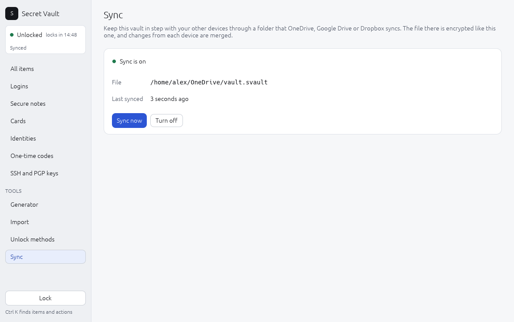

# 10. Sync between devices

Keep one vault on your laptop, desktop and work machine by putting a copy
of it in a folder that a cloud service already syncs: OneDrive, Google
Drive, Dropbox, iCloud Drive, Syncthing or a network share. Each device
merges its changes with that copy, so an item added on one shows up on
the others.

The service only ever sees the encrypted vault file. You don't give
Secret Vault any account or password for it, and the service gets no key.

Use it when:

- you want the same logins on a Windows desktop and a Linux laptop;
- you want an always up-to-date copy off the machine, as well as the
  backups in [chapter 8](08-troubleshooting.md#back-up-your-vault);
- you replace a computer and want the new one to pick up the vault
  without copying files by hand.

## Before you start

- Install the cloud service's own app on every device and let it finish
  syncing the folder. Secret Vault reads and writes ordinary files; the
  service does the uploading.
- Pick one path for the vault file inside that folder, for example:

  | System | Example path |
  |---|---|
  | Linux (Dropbox) | `~/Dropbox/vault.svault` |
  | Linux (Syncthing) | `~/Sync/vault.svault` |
  | Windows (OneDrive) | `C:\Users\Alex\OneDrive\vault.svault` |
  | Windows (Google Drive) | `G:\My Drive\vault.svault` |

  The folder can be at a different place on each device; only the file
  inside it must be the same.
- On Windows, set OneDrive or Google Drive to keep this file **always on
  this device** (right-click it, *Always keep on this device*). A file that
  is only downloaded on demand can make the first merge slow or fail until
  it arrives.

## Turn it on, on the first device

Unlock the vault, then either:

```sh
vault sync on ~/Dropbox/vault.svault
```

or in the desktop app choose **Sync** under *Tools* in the sidebar, type
the path in **File in the synced folder** and press **Turn on**.



The page then shows a green **Sync is on**, the file, and when the vault
last synced, with **Sync now** and **Turn off**. If something goes wrong
(the folder is missing, say) the dot turns red and the problem is spelled
out under it. Items changed on two devices at once, and leftover copies
your sync app made, are listed in a **Needs a look** box below.

Secret Vault writes your vault to that file at once. The status box at the
top of the sidebar now says **Synced**.

## Join from another device

Do this on a device that has **no vault yet**, with `vaultd` running and
the folder already synced there:

```sh
vault sync on ~/Dropbox/vault.svault   # joins the vault in that file
vault pair --password                  # pair this program by unlocking
```

In the desktop app, the *No vault yet* screen has a **Join** section below
*Create*: type the path, press **Join**, then unlock with the master
password.

The joined device unlocks with the same methods as the first: the master
password, the recovery code and any security key, whichever device enrolled
it. A **TPM** method works only on the computer whose TPM created it, so add
a TPM method on each computer separately if you want one
([chapter 2](02-unlocking.md)).

## Every day

There is nothing to do. While a device is unlocked, Secret Vault checks the
synced file every few seconds and merges whatever changed, and it merges
again before every save. A locked device reads and writes nothing; it
catches up when you next unlock it.

- `vault sync` shows the file, when it last merged and any problem.
- `vault sync now` (or **Sync now** in the app) merges straight away, for
  example right after the cloud app says it finished downloading.
- `vault sync off` (or **Turn off**) stops syncing on this device. The file
  in the folder stays, and the other devices keep using it.

## When two devices change the same item

- If only one device changed it, that change wins.
- If both changed it before they saw each other's change, the more recent
  edit wins and the other is kept as a new item titled
  *... (conflict)*. Look at both, keep what you want and delete the other.
- If one device deleted an item that another device edited, the edit wins
  and the item stays.
- A deleted item stays deleted: an old copy of the file cannot bring it
  back.

**Cloud conflict copies.** If two devices save before the service syncs,
the service may keep both, as `vault (1).svault`, `vault-LAPTOP.svault` or
`vault (conflicted copy).svault`. Secret Vault merges those too and
`vault sync` lists them as safe to delete. It never deletes files in the
folder itself, so delete them yourself once listed.

## Removing an unlock method

`vault revoke` (chapter 2) gives the vault a new key. The other devices
can't open the synced file with their old key, so they say the file was
re-keyed on another device and stop writing to it. The next time you unlock
one of them, it takes the new key and the remaining unlock methods, and
merges its own changes in.

A device that is never unlocked again keeps the old key and old unlock
methods in its own file. Syncing can't reach a copy that stays offline,
so wipe or remove a lost device's vault file if you can.

## Differences between systems

| | Linux | Windows | macOS |
|---|---|---|---|
| Sync through a folder | Yes | Yes | Not yet (`vaultd` does not run there yet) |
| Typical folders | Dropbox, Syncthing, Nextcloud, a network share | OneDrive, Google Drive, Dropbox | |
| Notes | Paths may start with `~/` | Keep the file *always on this device* | |

A vault synced between Linux and Windows works the same on both: the file
format is identical.

## Things to know

- The cloud service sees when the file changes and its (padded) size, the
  same as for any copy of the vault file.
- Each save uploads the whole file. That is fine for thousands of items.
- Conflicts are decided by each device's clock. A device with a badly wrong
  clock can win a conflict it should lose; the other edit is still kept as
  a *(conflict)* copy.
- A vault saved by this version can't be opened by older builds of Secret
  Vault, because its file now records which device changed each item.

For how the merge works inside, see [docs/sync.md](../sync.md).
