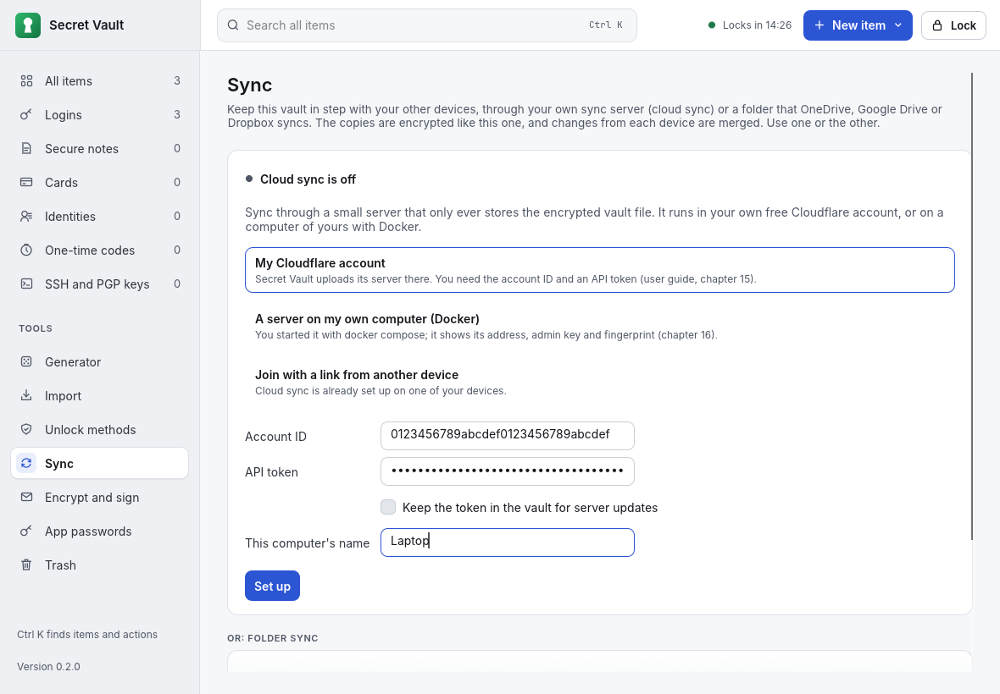
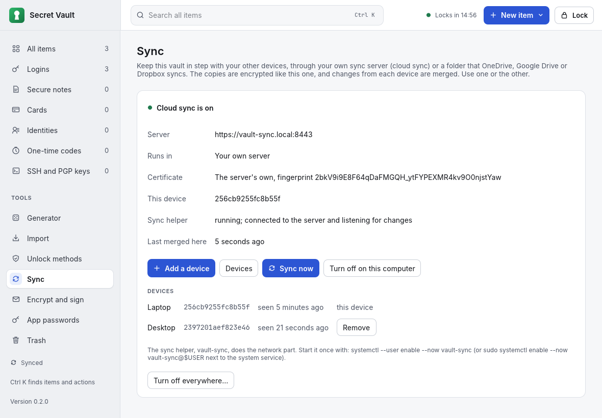
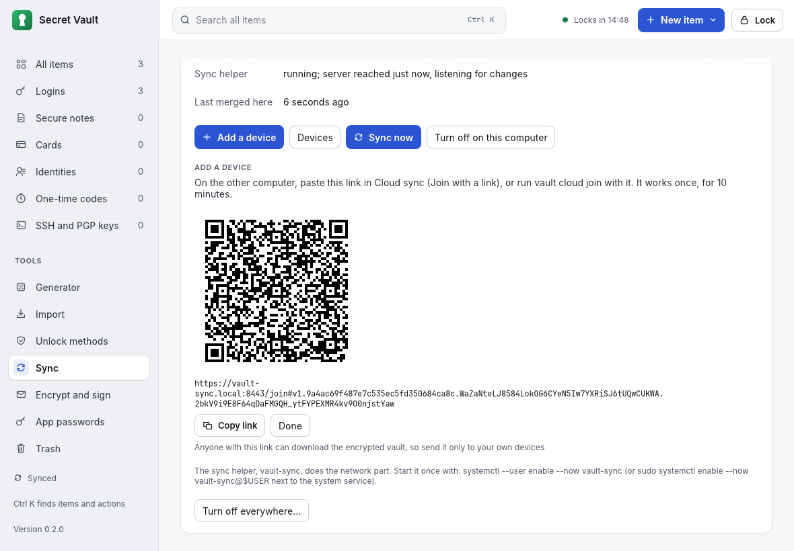
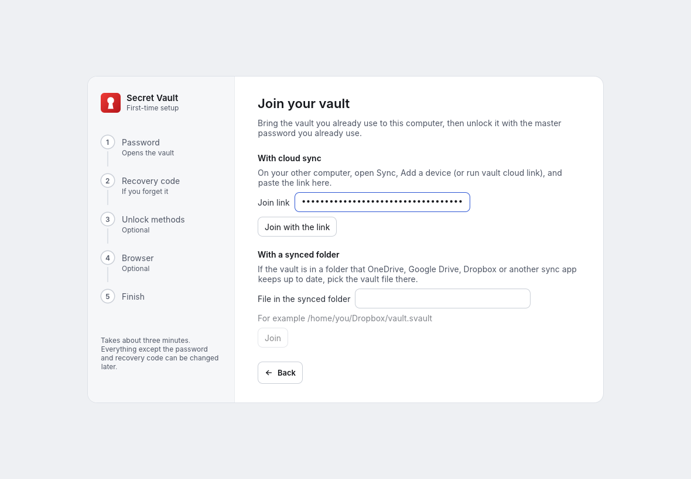

# 15. Cloud sync with your own Cloudflare account

Cloud sync keeps one vault on all your computers through a small sync
server that Secret Vault puts in **your own free Cloudflare account**. It
works like folder sync ([chapter 10](10-sync.md)) without a cloud drive app:
a change on one computer reaches the others within seconds, and there are
no "conflicted copy" files.

The server only ever stores the encrypted vault file. It never gets your
master password, your keys or your items, and nobody else runs it: it is in
your account, and only your vault can use it. It costs nothing on
Cloudflare's free plan.

Would you rather not use Cloudflare? The same server runs on a computer of
your own with Docker: see [chapter 16](16-cloud-sync-docker.md). Everything
after "Step 2" below works the same way for both.

Use cloud sync when:

- you want your logins on a Linux laptop, a Windows desktop and a Mac
  without installing OneDrive, Dropbox or Google Drive on each;
- you use Linux, where OneDrive and Google Drive have no official app;
- you want changes to show up on your other computers quickly.

You can still use folder sync instead. Use one or the other on a device,
not both.

> Phones and tablets cannot join cloud sync yet: that is coming next. Until
> then, phones keep using folder sync.

## What you need

- A free Cloudflare account. No card is needed.
- Secret Vault on each computer, with `vaultd` running and the vault
  unlocked on the first one.
- About ten minutes for the first computer, two for each other one.

## The parts, in one picture

```
 Laptop                        your Cloudflare account          Desktop
 ┌──────────────┐              ┌──────────────────┐             ┌──────────────┐
 │ Secret Vault │──vault-sync──│ Worker            │──vault-sync─│ Secret Vault │
 │ (your vault) │   (helper)   │ "vault-sync":     │  (helper)   │ (same vault) │
 └──────────────┘              │ encrypted file +  │             └──────────────┘
                               │ device tokens     │
                               └──────────────────┘
```

`vault-sync` is a small helper program that runs in the background on each
computer and does the uploading and downloading. `vaultd` itself never goes
on the internet.

## Step 1: make the Cloudflare account and an API token

Do this once, in a web browser. Cloudflare changes its dashboard from time
to time; if a button has moved, look for the same words nearby.

### 1.1 Sign up

1. Go to [dash.cloudflare.com/sign-up](https://dash.cloudflare.com/sign-up).
2. Enter an email address and a password, and click **Sign up**.
3. Open the email Cloudflare sends and click the link in it to confirm your
   address.
4. If Cloudflare asks what you want to do first ("add a domain", "build an
   app"…), skip it. You do not need a domain or a website.

### 1.2 Pick your workers.dev name

1. In the menu on the left, click **Workers & Pages** (sometimes under
   **Compute (Workers)**).
2. The first time, Cloudflare asks you to choose a **workers.dev
   subdomain**. Type a short name, such as `example-name`, and confirm. Your
   sync server will be at `https://vault-sync.example-name.workers.dev`.
   Anyone can see this name, so do not use your own name or email address.
3. If Cloudflare offers a plan, keep **Free**.

### 1.3 Copy the account ID

Still on **Workers & Pages**, find **Account ID** on the right side of the
page (a 32-character code of letters `a` to `f` and digits). Click the copy
icon next to it and keep it for step 2. You can also find it under
**Account home**, the three dots next to your account name, **Copy account
ID**.

### 1.4 Make an API token

The token lets Secret Vault upload the sync server to your account. It can
do nothing else.

1. Click the person icon at the top right, then **My Profile**.
2. On the left, click **API Tokens**, then **Create Token**.
3. Next to **Edit Cloudflare Workers**, click **Use template**.
4. Under **Account Resources**, pick **Include** and your account.
5. Under **Zone Resources**, pick **Include** and **All zones**. (Nothing
   uses a zone; the template just needs a choice.)
6. Leave the rest as it is. Click **Continue to summary**, then **Create
   Token**.
7. Click **Copy** next to the token. **Cloudflare shows it only once.** Keep
   it for step 2.

Treat the token like a password: whoever has it can change or delete your
sync server (though not read your vault). Never paste it in a chat or an
email.

## Step 2: set up the first computer

Pick the desktop app or the command line; they do the same thing.

### In the desktop app

1. Unlock the vault and click **Sync** in the sidebar.
2. Under **Cloud sync is off**, pick **My Cloudflare account**.
3. Paste the **Account ID** and the **API token**.
4. Leave **Keep the token in the vault for server updates** off unless you
   want `Update the server` to work later without making a new token.
5. Check **This computer's name** (it shows in the device list) and click
   **Set up**.



It takes up to a minute: Secret Vault checks your account, uploads its
server, waits for the new address to answer, and makes a mailbox for your
vault. Then the card says **Cloud sync is on**.

### With the command line

With the vault unlocked:

```sh
vault cloud setup
```

It asks for the account ID and the token (the token is not shown as you
paste it), then:

```
Checking your Cloudflare account...
Uploading the sync server as the Worker "vault-sync"...
Waiting for https://vault-sync.example-name.workers.dev to answer (a new address can take a minute)...
Cloud sync is set up on https://vault-sync.example-name.workers.dev.
```

| Option | What it does |
|---|---|
| `--keep-token` | Keep the API token in the vault so `vault cloud update` does not ask for it. Without it, the token is forgotten after setup |
| `--worker NAME` | Use another Worker name than `vault-sync` |
| `--name NAME` | How this computer appears in the device list (default: its name) |
| `--account ID` | Give the account ID on the command line |

### What just happened

Secret Vault uploaded its sync server to your account as a Worker called
`vault-sync`, made a mailbox for your vault, and saved the server's address
and keys **inside your vault** (encrypted), so your other computers learn
them when they join.

If you did not keep the token, you can delete it now in the Cloudflare
dashboard (**My Profile**, **API Tokens**, the three dots, **Delete**). You
only need a new one to update the server later.

## Step 3: start the sync helper

The helper, `vault-sync`, must run on every computer that uses cloud sync.
Start it once; after that it starts by itself.

| Your computer | What to do |
|---|---|
| Linux, `vaultd` as your own user service (the default with `install.sh`) | `systemctl --user enable --now vault-sync` |
| Linux, the system service `vaultd@you` (the default with the `.deb`, the Arch package and `get.sh`) | `sudo systemctl enable --now vault-sync@$USER` |
| Windows | Not in the installer yet. Build it with `cargo build --release -p vault-cloud`. Press Win+R, type `shell:startup`, press Enter, and in the folder that opens make a shortcut to `target\release\vault-sync.exe`. Double-click the shortcut once to start it now |
| macOS | Not in the `.pkg` yet. Build it with `cargo build --release -p vault-cloud`, then run `target/release/vault-sync &` in Terminal (again after each restart) |

The Linux packages (`.deb`, Arch package, `.tar.gz` with `install.sh` or
`get.sh`) include the helper and its service files. If you built from
source on Linux, copy `contrib/systemd/vault-sync.service` to
`~/.config/systemd/user/`, fix its `ExecStart=` path, and run the command
above.

Check it: the **Sync** page shows **Sync helper: running; connected to the
server and listening for changes**, and `vault cloud` prints the same. On
Linux, `journalctl --user -u vault-sync` (or `sudo journalctl -u
vault-sync@$USER`) shows what the helper did.



## Step 4: add your other computers

### On the first computer: make a link

In the desktop app, click **Add a device** on the **Sync** page. It shows a
QR code and a link like
`https://vault-sync.example-name.workers.dev/join#v1.…`, with **Copy link**.
On the command line, `vault cloud link` prints the same.



The link works **once** and for **10 minutes**. It contains no password or
key, but it lets a device download the encrypted vault, so send it only to
yourself: copy it into a note to yourself, a password-protected chat with
yourself, or type it, not a public chat.

### On the new computer: join

Install Secret Vault and make sure `vaultd` is running.

**In the desktop app**, on a computer with no vault yet: on the welcome
screen click **I already use Secret Vault on another device**, paste the
link under **With cloud sync**, and click **Join with the link**. Then
unlock with your master password.



On a computer that is already unlocked (for example one that used folder
sync before), open **Sync**, pick **Join with a link from another device**,
paste the link and click **Join**.

**On the command line:**

```sh
vault cloud join 'https://vault-sync.example-name.workers.dev/join#v1.…'
vault pair --password        # only on a computer with no vault yet
vault unlock
```

Then start the sync helper there too (step 3). The vault, your items and
all unlock methods are now on both. A security key works on every computer;
a TPM unlock method only works on the computer that made it.

If the new computer already had a different vault, its copy is refused
(a vault only merges with itself): stop `vaultd`, move that vault file
aside ([chapter 8, "Where your files are"](08-troubleshooting.md#where-your-files-are)),
start `vaultd` again and join.

## Everyday use

There is nothing to do. Edit on any computer while it is unlocked; the
others pick the change up within seconds while they are unlocked, or at
their next unlock. Two computers editing the same item at the same time
keep both edits: the later one wins and the other is kept as a copy titled
"(conflict)", as with folder sync.

| In the app (Sync page) | Command | What it does |
|---|---|---|
| The card | `vault cloud` | Server, this device, the helper, last sync, and whether the server needs an update |
| **Devices** | `vault cloud devices` | Every device that joined, and when it was last seen |
| **Remove** next to a device | `vault cloud remove ID` | Cut off a lost or sold device (it keeps what it already had) |
| | `vault cloud update` | Upload the newer server that came with a Secret Vault update |
| | `vault cloud forget-token` | Stop keeping the Cloudflare API token in the vault |
| **Turn off on this computer** | `vault cloud off` | Stop cloud sync on this computer only |
| **Turn off everywhere…** | `vault cloud off --everywhere` | Delete the vault from the server and the settings from the vault |

### A device was lost or stolen

1. On another computer: **Sync**, **Devices**, **Remove** next to it (or
   `vault cloud devices`, then `vault cloud remove ID`). The lost device can
   no longer download or upload.
2. It still has its own copy of the vault, protected by your master
   password and unlock methods. If you think someone may get past them,
   change the master password and revoke its unlock methods
   ([chapter 2](02-unlocking.md)).

### Running your own server by hand

If you would rather deploy the server yourself (for example with your own
Cloudflare settings), run `npm ci`, `npx wrangler deploy` and
`npx wrangler secret put ADMIN_KEY` (any random value) in `server/sync` of
the source code, then `vault cloud setup --server https://your-address` (or
**A server on my own computer** in the app, with the fingerprint empty).
`vault cloud update` does not work for such a server; deploy again with
`wrangler` instead.

## What differs between systems

| | Linux | Windows | macOS |
|---|---|---|---|
| Desktop app Sync page and `vault cloud` | Yes | Yes | Yes |
| Background helper | In the packages; systemd service, starts with the computer or at sign-in | Build from source; Startup folder shortcut | Build from source; start it yourself |
| Phones and tablets | Coming next (use folder sync until then) | | |

## Troubleshooting

| Message | What to do |
|---|---|
| `your account has no workers.dev subdomain yet` | Open **Workers & Pages** in the dashboard once and pick one (step 1.2) |
| `Cloudflare said Authentication error` | Check the account ID and that the token has *Workers Scripts: Edit* for that account |
| `a Worker named vault-sync already exists and is not a Secret Vault server` | Use `--worker` with another name |
| `this join link was used already or has expired` | Make a new link; each link works once, for 10 minutes |
| `the server said 401 ... this device may have been removed` | The device was removed: get a new link and join again |
| **Sync helper: not started on this computer yet** or **not running** | Start it (step 3) |
| "synced: not yet (unlock to sync)" | Unlock the vault; syncing happens only while it is unlocked |
| Changes do not arrive | Check that the helper is running on both computers and the Sync page shows no problem |

How it works inside, and what the server can and cannot see:
[docs/cloud-sync.md](../cloud-sync.md).
