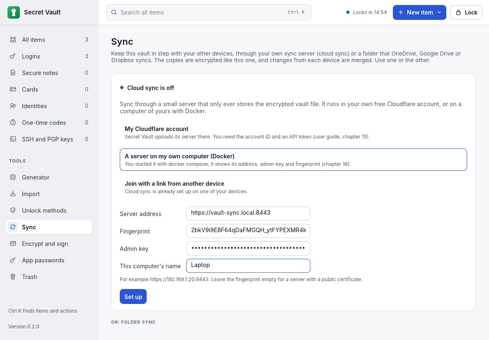

# 16. Cloud sync with a server on your own computer (Docker)

This is cloud sync ([chapter 15](15-cloud-sync.md)) with the sync server on
a computer in your home instead of in a Cloudflare account. Nothing leaves
your home network, and you need no account anywhere. The server is the same
program Cloudflare would run, started in **Docker**.

Pick this when:

- you would rather not have a Cloudflare account;
- you have a computer that is on most of the time (a desktop, a small home
  server, a NAS that runs Docker, a Raspberry Pi 4 or newer);
- your devices are at home most of the time. Away from home they sync again
  when they get back, or through a VPN to your home (see "Away from home").

As with Cloudflare, the server only ever stores the encrypted vault file. It
never sees your master password, keys or items.

## What you need

- One computer that runs the server. It can also be one of the computers
  you use the vault on, or not.
- Docker on that computer (step 1).
- Secret Vault on each computer that syncs, with `vaultd` running and the
  vault unlocked on the first one.
- About twenty minutes the first time.

## The parts, in one picture

```
 Laptop                     the server computer (at home)        Desktop
 ┌──────────────┐           ┌───────────────────────────┐        ┌──────────────┐
 │ Secret Vault │─vault-sync│ Docker container          │vault-sync Secret Vault │
 │ (your vault) │──────────▶│ "vault-sync", port 8443:   │◀───────│ (same vault) │
 └──────────────┘   https   │ encrypted file + tokens   │ https  └──────────────┘
                            │ in the volume /data       │
                            └───────────────────────────┘
```

The server makes **its own certificate** the first time it starts, so the
connection is encrypted without buying or registering anything. Each device
checks that certificate against a **fingerprint** that the join link
carries, so another computer on your network cannot pretend to be your
server.

## Step 1: install Docker on the server computer

| The server computer | What to install |
|---|---|
| Linux (Debian, Ubuntu) | `sudo apt install docker.io docker-compose-v2`, then `sudo usermod -aG docker $USER`, sign out and back in |
| Linux (Arch) | `sudo pacman -S docker docker-compose`, `sudo systemctl enable --now docker`, then `sudo usermod -aG docker $USER`, sign out and back in |
| Linux (Fedora and others) | Docker Engine from [docs.docker.com/engine/install](https://docs.docker.com/engine/install/) |
| Windows 10/11 | [Docker Desktop](https://docs.docker.com/desktop/setup/install/windows-install/). Keep **Use WSL 2** ticked during setup, and restart when it asks |
| macOS | [Docker Desktop](https://docs.docker.com/desktop/setup/install/mac-install/) (pick Apple silicon or Intel). Open it once from Applications |

Docker Desktop is free for personal use. On Windows and macOS, open
**Docker Desktop → Settings → General** and tick **Start Docker Desktop when
you sign in**, so the server comes back after a restart.

Check that it works: open a terminal (on Windows, PowerShell) and run

```sh
docker compose version
```

It prints a version such as `Docker Compose version v2.29.0`. If it says
`command not found`, Docker is not installed or (on Linux) you have not
signed out and back in yet.

## Step 2: get the server files

The server is in the `server/sync` folder of the Secret Vault source code.

With git:

```sh
git clone https://github.com/nishantnkumar-cell/PasswordVault.git
cd PasswordVault/server/sync
```

Without git: on the GitHub page, click **Code**, then **Download ZIP**,
unpack it, and open a terminal in the `server/sync` folder inside it.

## Step 3: give the server a fixed address

Your other devices find the server by its address on your home network.
That address must not change, or the devices lose it.

### 3.1 Find the computer's address

| The server computer | How |
|---|---|
| Linux | `ip -4 addr show scope global`; the address after `inet`, such as `192.168.1.20` |
| Windows | `ipconfig` in PowerShell; **IPv4 Address** under your Wi-Fi or Ethernet adapter |
| macOS | **System Settings → Wi-Fi** (or **Network**), **Details…** next to your network; **IP address** |

Home addresses almost always start with `192.168.`, `10.` or `172.16.` to
`172.31.`.

### 3.2 Keep it fixed

Open your router's page (often [192.168.1.1](http://192.168.1.1) or
[192.168.0.1](http://192.168.0.1); the address and password are usually on
a sticker on the router). Look for **DHCP reservation**, **Address
reservation** or **Static lease**, pick the server computer from the list,
and save. The name differs between routers; the router's manual or support
page has the exact steps.

You can use a name instead of, or as well as, the address. Many home
networks let other devices reach a Mac or Linux computer as
`computername.local`. Both work; the address is the most reliable.

### 3.3 Put it in compose.yaml

Open `compose.yaml` in a text editor and change the address on the
`SYNC_HOSTS` line to yours:

```yaml
    environment:
      SYNC_HOSTS: "192.168.1.20"
```

To use both a name and the address, list both, separated by a comma:
`"vault-sync.local,192.168.1.20"`. The first one is the address that setup
shows you.

Leave the rest as it is. If port 8443 is already used on that computer,
change the **first** number of `"8443:8443"` (for example `"9443:8443"`) and
add a line `SYNC_PUBLIC_PORT: "9443"` under `SYNC_HOSTS`.

## Step 4: start the server

In the `server/sync` folder:

```sh
docker compose up -d --build
```

The first time it downloads and builds for a few minutes. Then:

```sh
docker compose exec vault-sync show
```

prints what you need for step 6:

```
Secret Vault sync server
  address:      https://192.168.1.20:8443
  certificate:  DNS:localhost,IP:127.0.0.1,IP:192.168.1.20
  fingerprint:  tbCvXr6N001Lm6NUgBwIgyL5MjAWEOiHLXJ0gQT5dRQ
  admin key:    3q9V…
On the first computer, with the vault unlocked:
  vault cloud setup --server https://192.168.1.20:8443 --fingerprint tbCvXr6N001Lm6NUgBwIgyL5MjAWEOiHLXJ0gQT5dRQ
```

- The **fingerprint** identifies the server's own certificate. It stays the
  same as long as you keep the Docker volume.
- The **admin key** lets setup make a mailbox for your vault. Keep it to
  yourself, like a password. Only setup needs it.

`restart: unless-stopped` in `compose.yaml` starts the server again by
itself after a restart of the computer or of Docker.

## Step 5: let the other devices in (firewall)

Devices reach the server on port 8443 (or the one you picked).

| The server computer | What to do |
|---|---|
| Linux with no firewall (Debian, Ubuntu default) | Nothing |
| Linux with `ufw` | `sudo ufw allow 8443/tcp` |
| Linux with `firewalld` (Fedora) | `sudo firewall-cmd --permanent --add-port=8443/tcp` then `sudo firewall-cmd --reload` |
| Windows | The first time, Windows may ask whether to allow Docker Desktop on **Private networks**: click **Allow**. If it did not ask, run in PowerShell as administrator: `New-NetFirewallRule -DisplayName "Secret Vault sync" -Direction Inbound -Protocol TCP -LocalPort 8443 -Action Allow -Profile Private` |
| macOS | If **System Settings → Network → Firewall** is on, allow incoming connections for Docker when macOS asks |

On Windows, make sure your home network is set to **Private**, not
**Public** (**Settings → Network & internet → Wi-Fi** or **Ethernet**, your
network, **Network profile type**).

Check it from another computer, with the address from `show`:

```sh
curl -k https://192.168.1.20:8443/ca.pem
```

It prints a block that starts with `-----BEGIN CERTIFICATE-----`. (`-k`
skips the certificate check for this test only; Secret Vault checks the
fingerprint instead.) If it hangs or says `Connection refused`, look at the
firewall and the address again.

## Step 6: set up the first computer

On the computer whose vault you want to sync (it can be the server computer
itself), unlock the vault.

### In the desktop app

1. Click **Sync** in the sidebar.
2. Under **Cloud sync is off**, pick **A server on my own computer
   (Docker)**.
3. Fill in **Server address**, **Fingerprint** and **Admin key** from the
   `show` output, and check **This computer's name**.
4. Click **Set up**.



After a few seconds the card says **Cloud sync is on** and shows
**Runs in: Your own server** and the certificate's fingerprint.

### With the command line

Copy the line that `show` printed at the end:

```sh
vault cloud setup --server https://192.168.1.20:8443 --fingerprint tbCvXr6N001Lm6NUgBwIgyL5MjAWEOiHLXJ0gQT5dRQ
```

It asks for the admin key (not shown as you paste it). Add `--name NAME` to
choose how this computer appears in the device list.

The server's address, its certificate, the admin key and your mailbox's
keys are saved **inside your vault** (encrypted), so your other computers
learn them when they join.

## Step 7: start the sync helper, and add your other computers

From here on, everything is the same as with Cloudflare:

- Start the sync helper `vault-sync` on this computer:
  [chapter 15, step 3](15-cloud-sync.md#step-3-start-the-sync-helper).
- Add your other computers with a one-time link (**Add a device** on the
  Sync page, or `vault cloud link`):
  [chapter 15, step 4](15-cloud-sync.md#step-4-add-your-other-computers).
  The link already carries the fingerprint, so the new computer needs
  nothing else.
- Everyday use, removing a lost device and turning it off:
  [chapter 15, "Everyday use"](15-cloud-sync.md#everyday-use).

`vault cloud update` is for Cloudflare only. To update a server of your own,
see "Updating the server" below.

## Away from home

The server is only reachable on your home network. A laptop that is away
keeps working with its own copy: its changes stay on it and sync when it is
home again, and the others' changes arrive then too.

To sync while away, connect to your home network with a VPN, such as
WireGuard on your router or a free mesh VPN like Tailscale. Add the address
the VPN gives the server computer to `SYNC_HOSTS` (for example
`"192.168.1.20,100.64.0.7"`) and run `docker compose up -d` again: the
server makes a new certificate with the same fingerprint, so devices that
already joined keep working. Devices use the address that was in the link
they joined with, so join the laptop with a link made after this change,
or make sure the first address in `SYNC_HOSTS` works from everywhere.

Do not open port 8443 on your router to the whole internet. The server
needs a device token for everything, but there is no reason to show it to
the world.

## Keeping it running

| What | How (in `server/sync`) |
|---|---|
| Is it running? | `docker compose ps` (shows `Up`) |
| What did it do? | `docker compose logs --tail 50` |
| Stop it | `docker compose stop` |
| Start it again | `docker compose start` |
| Show the address, fingerprint and admin key again | `docker compose exec vault-sync show` |

### Updating the server

When a new Secret Vault version changes the server, the Sync page and
`vault cloud` say **the server needs an update**. Then, in the source
folder:

```sh
git pull
cd server/sync
docker compose up -d --build
```

(Without git, download the ZIP again and run the last command in its
`server/sync` folder.) Your vault, the certificate and the fingerprint are
in the volume and stay as they are.

### Backing it up

The volume holds the encrypted vault files, the device tokens and the
server's certificate. Every computer that syncs also has a full copy of the
vault, so a lost volume loses no items; what you would lose is the
certificate and the devices' sign-ins, and you would set cloud sync up again.

To keep a copy of the volume anyway (Linux and macOS; on Windows use
`${PWD}` instead of `$PWD`):

```sh
docker compose stop
docker run --rm -v sync_vault-sync-data:/data -v "$PWD":/backup ubuntu:24.04 tar czf /backup/vault-sync-backup.tgz -C /data .
docker compose start
```

The volume's name is the folder name plus `_vault-sync-data`; `docker volume
ls` lists it if yours differs.

### Moving the server to another computer

1. Back up the volume on the old computer (above).
2. On the new one, do steps 1 and 2, create the volume and restore into
   it:

   ```sh
   docker volume create sync_vault-sync-data
   docker run --rm -v sync_vault-sync-data:/data -v "$PWD":/backup ubuntu:24.04 tar xzf /backup/vault-sync-backup.tgz -C /data
   ```

3. Give the new computer **the same fixed address** as the old one, or add
   its address to `SYNC_HOSTS`, then `docker compose up -d --build`. With
   the same address, the devices notice nothing. With a new address, turn
   cloud sync off and set it up again (step 6 and a new link for each
   device), because the devices remember the old address.

### Removing it

**Turn off everywhere…** on any one computer (or `vault cloud
off --everywhere`) deletes the vault from the server and the settings from
the vault. Then, on the server computer: `docker compose down -v` deletes
the container and the volume.

## What differs between systems

| | Linux | Windows | macOS |
|---|---|---|---|
| Run the server | Docker Engine, or Docker Desktop | Docker Desktop (WSL 2) | Docker Desktop |
| Starts by itself after a restart | Yes (`restart: unless-stopped`, Docker starts at boot) | When Docker Desktop starts at sign-in, so someone must sign in | Same as Windows |
| Firewall | Usually nothing, or `ufw` / `firewalld` | Allow on Private networks | Allow Docker if asked |
| Desktop app and `vault cloud` on the devices | Yes | Yes | Yes |
| Sync helper on the devices | In the packages | Build from source | Build from source |

A computer that is always on and runs Linux is the easiest place for the
server, because Docker Engine starts with the computer without anyone
signing in.

## Troubleshooting

| What you see | What to do |
|---|---|
| `docker: permission denied ... docker.sock` (Linux) | Run `sudo usermod -aG docker $USER`, then sign out and back in |
| `Bind for 0.0.0.0:8443 failed: port is already allocated` | Another program uses the port: pick another one (step 3.3) |
| `could not reach the server` | Check the address and port from `show`, the firewall (step 5), and that both computers are on the same network |
| `the server's certificate does not have that fingerprint` | The fingerprint was mistyped, or this is not your server. Copy it again from `show`. If you deleted the volume, the server has a new fingerprint: set cloud sync up again |
| `wrong admin key` | Copy it again from `show`, without spaces |
| `vault cloud update` says `this server was set up by hand` | Normal for your own server; see "Updating the server" |
| It worked, then stopped after a restart | `docker compose ps`; on Windows and macOS, check that Docker Desktop starts at sign-in |
| Works at home, not away | Expected without a VPN (see "Away from home") |

The messages that are the same for both kinds of server are in
[chapter 15, "Troubleshooting"](15-cloud-sync.md#troubleshooting). How the
server and the certificate check work inside:
[docs/cloud-sync.md](../cloud-sync.md).
