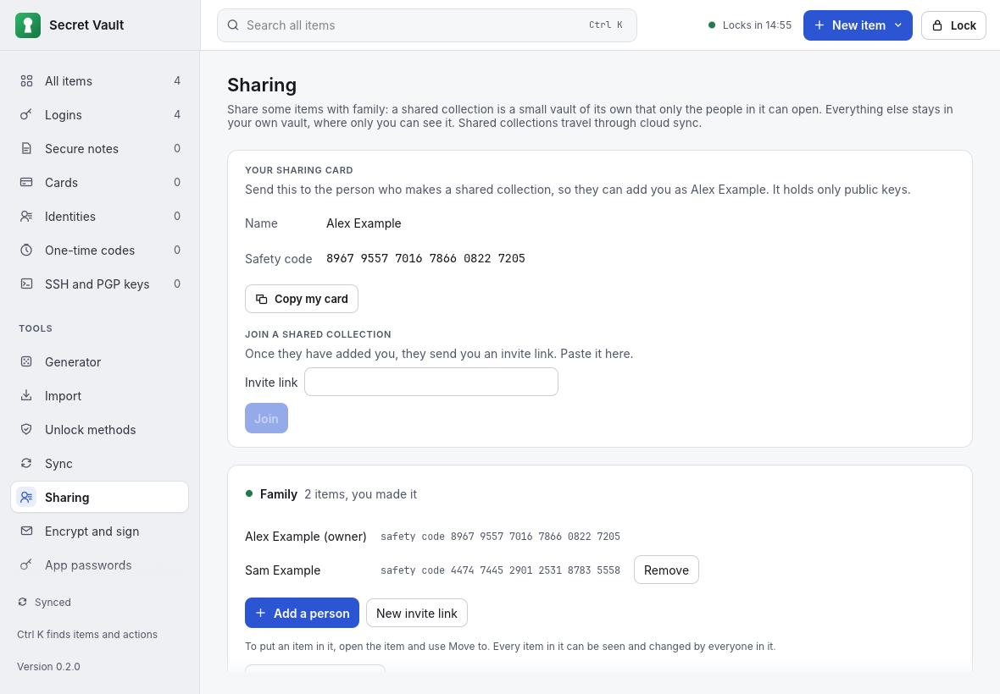
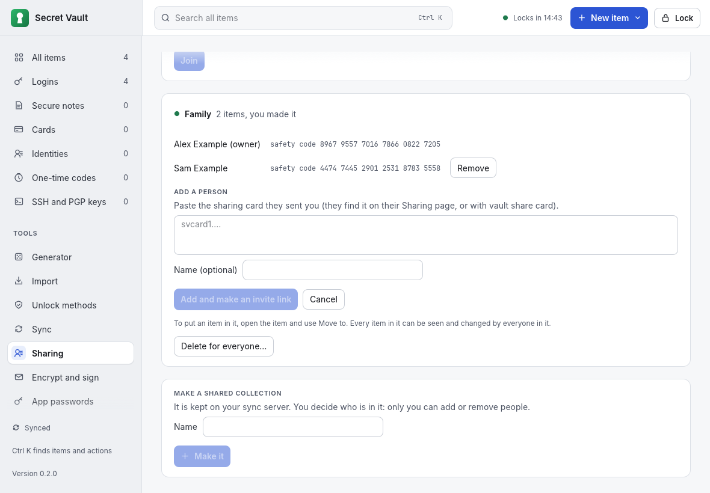
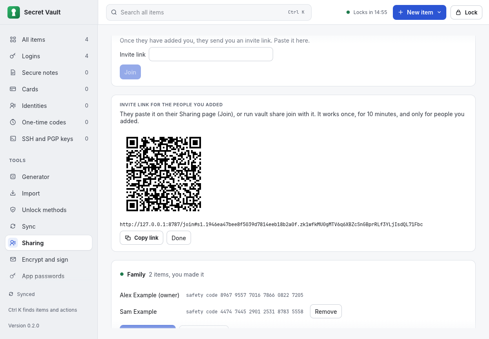
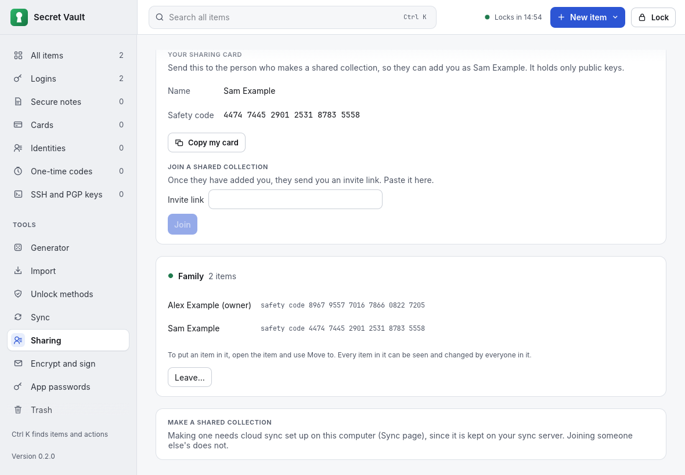
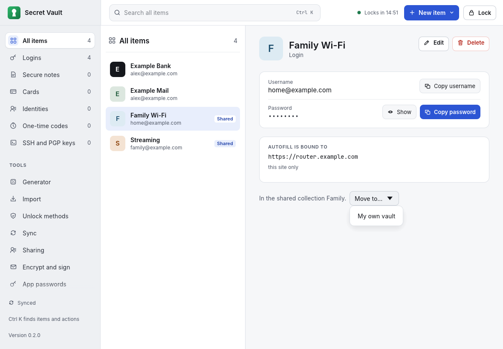

# 17. Sharing with family

Share a few items, such as the Wi-Fi password or the streaming account, with
the people you live with, and keep everything else to yourself. Each person
has their own vault and master password, as before. What you share goes in a
**shared collection**: a small vault of its own that only the people in it
can open.

- Whoever makes a collection is its **owner**. Only the owner can add or
  remove people, or delete it.
- Everyone in it can see, change, add and delete the items in it.
- An item is either in your own vault or in one shared collection. Moving it
  is one click, either way.
- When the owner removes someone, the collection gets a new key. That person
  keeps what they already had, and gets nothing new.

The examples use two people, Alex Example (who makes the collection) and Sam
Example (who joins). How it works inside is in [docs/sharing.md](../sharing.md).

## What you need

- **The owner** needs cloud sync set up on their computer: either
  [chapter 15](15-cloud-sync.md) (Cloudflare) or
  [chapter 16](16-cloud-sync-docker.md) (Docker). The collection is kept on
  that same server.
- **Everyone else** needs a version of Secret Vault with family sharing
  (see the [release notes](../release-notes.md)) on a computer, with
  `vaultd` running and their vault unlocked, and the sync helper `vault-sync`
  running ([chapter 15, step 3](15-cloud-sync.md#step-3-start-the-sync-helper)).
  They do not need cloud sync for their own vault, or any account.
- A few minutes together, in person or on a call, for the safety codes.

## Step 1: everyone makes a sharing card

A sharing card holds your name and your public keys, nothing secret. You make
it once; it stays in your vault and reaches your other devices by sync.

**In the desktop app:** open **Sharing** in the sidebar, type the name your
family will see you as, and click **Make my sharing card**. The page then
shows your name and **safety code**, and **Copy my card**.

**With the command line:**

```
vault share card --name "Sam Example"
```

It prints the card (a long line starting with `svcard1.`) and your safety
code.

Everyone except the owner now sends their card to the owner, by email, chat or
anything else. It is safe to send openly: the safety code check in step 3 is
what makes sure it wasn't swapped on the way.

## Step 2: the owner makes a shared collection

**In the desktop app:** on the **Sharing** page, under **Make a shared
collection**, type a name such as `Family` and click **Make it**.

**With the command line:**

```
vault share create Family
```



## Step 3: the owner adds each person

**In the desktop app:** in the collection, click **Add a person**, paste their
card, and click **Add and make an invite link**.



**With the command line:**

```
vault share add Family 'svcard1.…'
```

You now see their **safety code** and a one-time **invite link** with a QR
code. Before you send the link:

1. Call them, or sit together.
2. Read them the safety code shown next to their name, and have them check it
   against the one on their own Sharing page (or `vault share card`).
3. Have them read your code to you, and check it against yours.

If a code doesn't match, don't send the link: the card was changed on the way.
Remove the person and ask them to send the card again another way.



The link works once, for 10 minutes, and only for someone you added. If it
runs out, click **New invite link** (or `vault share invite Family`).

## Step 4: they join

**In the desktop app:** on the **Sharing** page, paste the link under **Join a
shared collection** and click **Join**.

**With the command line:**

```
vault share join 'https://…/join#s1.…'
```

The collection shows up with its people and their safety codes. Check that the
owner's code is the one they read to you. Your other computers get it on their
own at the next sync; you don't need another link.



## Everyday use

**Share an item.** Open it, click **Move to…** under it, and pick the
collection. It moves out of your own vault, and everyone in the collection has
it after the next sync (a few seconds when everyone's `vault-sync` is
running). Shared items have a **Shared** tag in the list. **Move to… → My own
vault** takes one back.



With the command line:

```
vault ls                     # shared items say [shared: Family]
vault share move fed1ac4e Family
vault share move fed1ac4e --mine
```

(`fed1ac4e` is the start of the item's ID, as `vault ls` shows it.)

Browser autofill, copying, codes and search work the same for shared items.

**See who is in it.** The Sharing page, or `vault share list`.

## Removing someone, leaving, deleting

**Remove a person** (owner only): click **Remove** next to them and confirm,
or `vault share remove Family "Sam Example"` (the start of their member
number from `vault share list` works too). The collection gets a new key, every item
in it is encrypted again, and their access on the server is deleted. They keep
the items they already had, so change a password that matters if you are
removing someone you don't trust.

**Leave** (members): **Leave…** in the collection, or
`vault share leave Family`. The items go from your devices; the others keep
them.

**Delete** (owner): **Delete for everyone…**, or `vault share leave Family`.
The items come back into your own vault, and the collection is deleted from
the server, so everyone else loses it.

## What differs between systems

| | Linux | Windows | macOS |
| --- | --- | --- | --- |
| Sharing page and `vault share` | Yes | Yes | Yes |
| Starting `vault-sync` | `systemctl --user enable --now vault-sync` (or the system unit next to `vaultd@`) | A shortcut in the Startup folder | `vault-sync &` in Terminal |
| Where collections are kept | Next to the vault file, in `shared/` | The same | The same |
| iPhone, iPad, Android | Cannot join a shared collection yet | | |

## Troubleshooting

**"make your sharing card first"**: do step 1 on this computer (or wait for
your vault to sync from a computer where you did).

**"Making one needs cloud sync set up on this computer"**: only the owner
needs cloud sync. Set it up ([chapter 15](15-cloud-sync.md) or
[16](16-cloud-sync-docker.md)), or let someone who has it make the collection.

**"this is a link to join your own vault on another device"**: that link is
for cloud sync of one person's vault (`#v1.`). Invite links have `#s1.` in
them; ask the owner for one from the Sharing page.

**A collection says "Problem: … 401 … this device may have been removed"**:
the owner removed you, or deleted the collection. Ask them to add you again,
or click **Leave…** to tidy up.

**Items don't show up on the other person's computer**: check that
`vault-sync` runs on both computers and that both vaults are unlocked; shared
collections sync only while the vault is unlocked.
