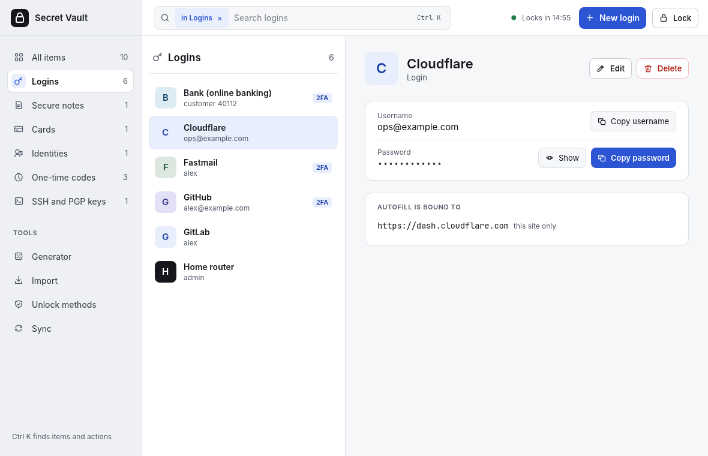
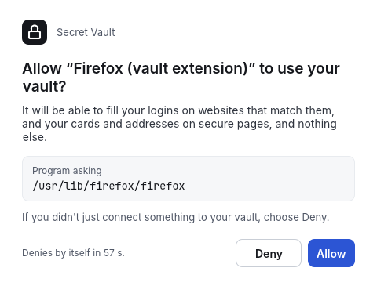

# The desktop app: window layout and the command palette

This guide is for people opening the desktop app (`vault-gui`) for the
first time. It covers how the window is laid out, how to find and copy
things quickly, and how to unlock. For installing the daemon and the app,
see [vaultd.md](../vaultd.md) and [desktop.md](../desktop.md).

The examples use a sample vault for "Alex Example".

## Before you start

The app is a window onto `vaultd`, the background service that holds your
vault. The app never reads the vault file itself. If the app says it can't
reach vaultd, start the service first:

- **Linux:** `systemctl --user start vaultd`
- **Windows:** if you used the installer, vaultd starts by itself when you
  sign in; otherwise start `vaultw.exe` (see
  [installing on Windows](windows-install.md)).
- **macOS:** not supported yet. The app and the daemon run on Linux and
  Windows today.

## Unlocking

When the vault is locked, the window shows one card with two columns. On
the left, under **Unlock with**, pick how to unlock: **Master password**,
**Security key**, **This device** (TPM) or **Recovery code**. On the right,
fill in what that method asks for and press **Unlock** (or Enter). If
Windows Hello quick unlock is on, an **Unlock with Windows Hello** button
sits above the form.

| Method | What you need | Linux | Windows |
| --- | --- | --- | --- |
| Password | Your master password | Yes | Yes |
| Security key | Your master password, then a touch on the key (and its PIN if it has one) | Yes | Yes (Windows shows its own window for the touch and PIN) |
| This device (TPM) | Your master password and, if you set one, the TPM PIN | Yes | Yes |
| Unlock with Windows Hello | Your face, fingerprint or Windows PIN; shown only while quick unlock is available | No | Yes |
| Recovery code | The code from your printed recovery sheet | Yes | Yes |

Only methods you have added under **Unlock methods** will work. The first time you open the app on a vault that already exists,
the same card pairs the app with the vault: unlock once, or press **Ask for
approval** and allow the app in the window vaultd opens.

## The window

Once unlocked, the window has a bar across the top and three columns
below it.

- **Top bar.** The **search bar** filters the item list by title, user
  name or website. While a category is open it searches only that
  category, shown by a blue tag such as **in Logins ×**; click the × to
  search all items. On the right, the time left before the vault locks
  itself if you leave it idle, the blue **New** button and **Lock**. The
  **New** button is named for the open category (**New login**, **New
  card**, **New SSH key** and so on); in All items it is **New item ▾**, a
  menu of every kind, including **SSH key** and **OpenPGP key**.

1. **Sidebar (left).** Each entry has an icon; the open one sits on a white
   button with a blue icon tile.
   - **All items**, **Logins**, **Secure notes**, **Cards**,
     **Identities**, **One-time codes** and **SSH and PGP keys** filter the
     item list, with the number of items in each next to it.
     *One-time codes* shows only items with a two-factor code
     set up; *SSH and PGP keys* shows only keys. The chosen category's
     name heads the item list, and an empty category says so and points
     you to the **New** button.
   - **Tools**: **Generator** (make a strong password), **Import** (bring
     items in from Bitwarden or a browser export), **Unlock methods**
     (add or remove ways to unlock) and **Sync** (keep the vault in step
     with your other devices).
   - At the bottom: the app's version and a reminder that Ctrl K finds
     items and actions.
2. **Item list (middle).** Each row shows a coloured letter tile, the title in
   bold and, under it, the user name,
   the card's network and last four digits, or the identity's name. A
   **2FA** tag means the item has one-time codes; **Key** means it is an
   SSH or PGP key.
3. **Details (right).** The item you picked.

### Item details

- Each field is a row with its name over its value and a Copy button on
  the right; the password's **Copy password** is the blue one.
- **Username** and **Password** each have a copy button. The password stays
  hidden until you press **Show**. Cards and identities show their own
  fields the same way; a card's number, security code and PIN, and any
  hidden custom field, stay hidden until **Show**.
- **One-time code** shows the current code with a ring that empties as the
  code nears its end. It turns orange in the last five seconds, so wait for
  the next code if you are typing it by hand.
- A **secure note** shows its text only after **Show**; **Copy note**
  copies it without showing it.
- **Autofill is bound to** (logins only) lists the websites the browser extension may
  fill this item on. *This site only* means exactly that address; *the
  whole domain* also covers its subdomains. An item with no websites is
  never offered for autofill.
- For SSH and PGP keys, the **Key** card shows the key type and
  fingerprint, the public key with a **Copy public key** button, and an
  **Ask before each use** tick box. The private key itself is never shown:
  vaultd signs and decrypts for you. See
  [SSH and PGP keys](05-desktop-app.md#ssh-and-pgp-keys).
- **Edit** and **Delete** sit at the top right. Delete asks you to confirm.

## The command palette (Ctrl K)

Press **Ctrl K** anywhere in the unlocked window to open a search box over
the window. It is the fastest way to work without the mouse.

1. Start typing part of a title, user name or website, for example `git`.
2. **Items** lists the matches. Press **Enter** to copy the highlighted
   item's password (for a key, card, identity or secure note, Enter opens
   it instead).
3. **Actions** offers more for the best match: copy the user name, copy the
   one-time code, or show the item.
4. **Vault** actions are always there: *New item* (a new login), *New SSH key*,
   *New OpenPGP key*, *Generate a password*, *Import items*, *Unlock methods* and *Lock now*. Type `lock` and press
   Enter to lock.

Use the **Up** and **Down** arrow keys to move, **Enter** to run, and **Esc**
(or a click outside the box) to close it. You can also click any row. Items
show their letter tile and user name, and the highlighted row shows the
Enter key to remind you that Enter runs it.

## The approval window

When a program asks to pair with the vault, fill a card or use a key, a
small window names the program and what it wants. **Deny** has the focus,
so pressing Enter never allows by accident. The window denies by itself
after a minute; the countdown is in its bottom left corner. The window
grows to fit its text, so long program paths are never cut off.

## Window size and look

- **The window fits the screen.** The main window opens centred and no
  larger than the free part of the screen, so the taskbar (or dock and top
  bar) and the title bar stay visible. On a 1920x1080 display at 150%
  scaling it opens at 1180x624. If you later make the window bigger than
  the screen, double-click the title bar (Windows) to fit it again. On
  Linux with Wayland the compositor decides where windows open, so it may
  not be centred.
- **Always light.** The app and its title bar stay light even when Windows
  or Linux is set to dark mode.
- **Same fonts everywhere.** The app ships its own fonts (Inter for text,
  JetBrains Mono for passwords, codes and keys), so it looks the same on
  every system.

Everything you copy, from the palette or the buttons, is cleared from the
clipboard after 30 seconds, when the vault locks and when the app closes.

## Keyboard shortcuts

| Action | Linux and Windows | macOS (when supported) |
| --- | --- | --- |
| Open or close the command palette | Ctrl K | Cmd K |
| Lock the vault | Ctrl L | Cmd L |
| Move in the palette | Up / Down | Up / Down |
| Run the highlighted row | Enter | Return |
| Close the palette | Esc | Esc |

## Differences between platforms

- **Clipboard history.** On Windows, copied secrets are marked so clipboard
  history (Win + V) and cloud clipboard sync skip them. On Linux the app
  can't mark them, so a clipboard manager may keep a copy even after the app
  clears the clipboard 30 seconds later. Turn off history in your clipboard
  manager, or exclude the app, if you use one.
- **Unlock methods.** TPM unlock works on Linux and Windows, but a TPM
  method added on one system does not open on the other. Security keys
  work on both; on Windows, Windows itself asks for the touch and the PIN in
  its own window. Quick unlock with Windows Hello is Windows only (see the
  table under *Unlocking*).
- **macOS** is not supported yet.
